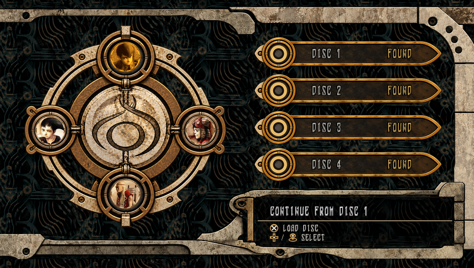

# Lagi

**Panzer Dragoon Saga / Azel — native PlayStation Vita runtime**

Lagi runs reconstructed Panzer Dragoon Saga game logic directly on the Vita's ARM CPU. It translates the original game's Saturn display and platform behavior into Vita services, with **Neptune** handling native SceGxm rendering. This is not a Saturn emulator and does not use VitaGL.

**Development status — 20 November 2026:** We have progressed from the opening sequence and Ruins through native flight, Excavation, Valley combat, world-map/camp transitions and the first Garil Desert encounters. The current working combat tree was restored at `977809e` after a WEAK-reticule experiment caused a Valley regression. Garil Scatter, escape movement, WEAK markers and later story sequences still need further hardware verification. **The game is not yet fully playable.**

## Current capabilities

- **Game flow:** Original movies, title, name entry, Ruins, native cinematics, flight, Excavation, Valley and active Garil integration. Azel remains responsible for scripts, tasks, timing and transitions.
- **Combat:** Native battle engine, gun and laser attacks, targeting, enemy lifecycles, results and progression. Coverage varies by formation and effect; missing Berserk visual producers are still being restored.
- **Neptune:** Native VDP1 models and sprites, textured/distorted quads, Gouraud lighting, mesh effects, VDP2 backgrounds and rotation, windows, palettes, color operations and fades.
- **Audio and movies:** Native game audio, runtime ARM SCSP DSP translation and Sega FILM/Cinepak playback.
- **Discs and saves:** Four-disc CUE/BIN selection, ISO9660 resource access and Vita storage through native save/load flows. Mounting four discs does not mean all four discs are fully playable.

We target the original **30 Hz** presentation. The current CMake profile enables full-resolution gameplay by default; visual coverage and performance still depend on the scene and the original effects workload.

## Disc setup

Supply your own legally obtained disc images in the appropriate folders:

```text
ux0:data/lagi/
  Disc 1/
    <disc>.cue
    <disc>.bin
  Disc 2/
  Disc 3/
  Disc 4/
```

Only present discs appear in the selector. No copyrighted game files are included in the repository. The selector is documented in [disc selection](docs/DISC_SELECTION_FRONTEND.md).



## How Lagi is organized

```text
Original PDS disc data
       |
Azel — game logic, tasks and script state
       |
Lagi — native Vita services and presentation bridge
       |
Neptune — SceGxm rendering
       |
     PS Vita
```

**Azel decides. Lagi services. Neptune renders.**

We work from the original game's code and data rather than simulating individual scenes or attacks with custom Vita substitutes. `extern/Azel` stays pinned to upstream; Vita adaptations live in Lagi.

## Documentation and builds

Start with [current status](docs/STATUS.md), [build instructions](docs/BUILDING.md) and the [documentation guide](docs/README.md). The technical details for Berserk support are in [Disc 1 Berserks](docs/BERSERKS_DISC1.md) and [battle effects recovery](docs/BATTLE_EFFECTS_RECOVERY.md). Dated engineering notes remain available for tracing original source addresses and earlier tests.

## AI-assisted development

Lagi uses AI-assisted development for research, implementation, debugging and documentation. I direct the architecture and priorities, and the results are checked against Azel, original disc data and real Vita behavior. A successful build or host test is not a substitute for hardware acceptance.

## Credits and legal

Lagi builds on **Azel**, **ATOLM**, **pds-tools**, **Yabause / Vita Yabause** and the wider Sega Saturn reverse-engineering community.

Panzer Dragoon Saga and its assets belong to Sega and their respective rights holders. Lagi is an independent community project; users must supply game files they are entitled to use.
