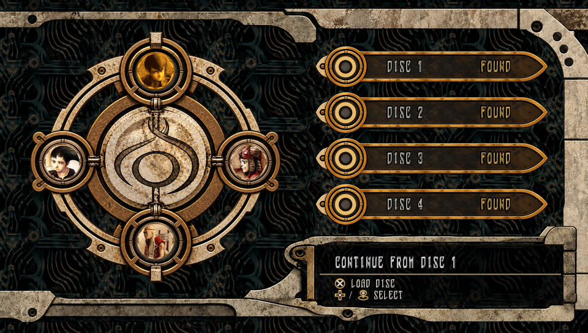

# Lagi

**Panzer Dragoon Saga / Azel — native PlayStation Vita runtime**

Lagi runs reconstructed *Panzer Dragoon Saga* game logic directly on the Vita's ARM CPU, translating Sega Saturn graphics and platform behavior to native Vita services and SceGxm through the **Neptune** renderer. It is **not a Sega Saturn emulator** and does **not use VitaGL**.

> **Development status (October 2026):** Gameplay has progressed through the first boss fight on real Vita hardware. The current development branch is ahead of the latest public release, **v0.3.0alpha**; the game is not yet fully playable.

## Current progress

The native game path includes opening movies, title and name entry, playable Ruins, elevator cinematics, FLD_A3 flight, the E006 in-engine cinematic, Excavation, random encounters, and the opening boss fight.

Major working systems:

- **Gameplay and combat:** Azel-owned tasks, scripts, camera, movement, collision, LCS, enemy encounters, battle logic, and scene transitions. Encounter RNG and formation selection have been checked against original disc-backed routines.
- **Neptune graphics:** Native GXM translation of VDP1 geometry, sprites, polylines, Gouraud lighting, mesh transparency, UI and effects; VDP2 normal/rotation backgrounds (including RBG0), tile maps, scrolling, line-scroll, palettes, priority composition, color offsets and fades. Most VDP2 behavior needed by the supported first-section scenes is implemented, but full hardware coverage is not claimed.
- **Audio and movies:** Native BGM and effects, runtime ARM translation of Saturn SCSP DSP programs, Sega FILM/Cinepak playback, and GPU-assisted presentation.
- **Display:** 480×272 default gameplay rendering, optional **native 960×544** geometry rendering with `LAGI_FULLRES=ON`, high-resolution title presentation, and screen-space lookup dithering.
- **Disc access:** CUE/BIN mounting, ISO9660 reads, and a hardware-accepted four-disc selection frontend.

Performance targets the original **30 Hz** presentation rate. Supported town and field sections can reach it; complex battles still experience frame-time spikes.

Current priorities include combat rewards and Berserk progression, field-map completion, VDP2 composition corrections in Excavation, transition accuracy, and battle/audio performance. See [first-section cleanup](docs/FIRST_SECTION_CLEANUP.md) and [development status](docs/STATUS.md) for detailed progress and validation notes.

## Disc selection

The 960×544 frontend detects available game discs, provides D-pad/left-stick selection, and mounts the chosen CUE/BIN before native Azel startup. It uses Saga-inspired artwork, the original PDS font and character art, music, and menu sounds derived from original game data. The selector, audio, mounting and fade handoff have been accepted on Vita hardware.



Place your own disc images in matching folders:

```text
ux0:data/lagi/
  Disc 1/
    <disc>.cue
    <disc>.bin
  Disc 2/
  Disc 3/
  Disc 4/
```

Only present discs are selectable. Four-disc selection does **not** imply full four-disc gameplay or in-game disc switching. See the [frontend guide](docs/DISC_SELECTION_FRONTEND.md) and [hardware acceptance notes](docs/ISO_LOADER_ACCEPTANCE_2026_10_23.md).

## Architecture

```text
Original PDS disc data
         |
  Azel reconstructed logic (ARM)
         |
  Lagi platform and presentation bridge
         |
  Neptune VDP1/VDP2 -> SceGxm
         |
      PS Vita
```

**Azel decides. Lagi services. Neptune renders.**

Azel owns gameplay state, tasks, scripts, timing, and scene decisions. Lagi supplies Vita input, disc access, memory, audio, synchronization, and other platform services. Neptune renders Azel's presentation state through the Vita GPU, without duplicating game logic in the renderer.

More implementation detail: [flight/rendering handoff](docs/FLIGHT_MODE_BRINGUP.md) · [dither performance](docs/DITHER_PERFORMANCE.md).

## Building and controls

A working VitaSDK installation and Sony `psp2cgc` are required. See [building instructions](docs/BUILDING.md).

Controls are mapped from Vita input to the Saturn input state expected by Azel; available actions depend on the game mode. The public alpha's Ruins/movie controls are documented in [development status](docs/STATUS.md). Neptune retains Full, Texture, Lighting, Quads, and Wires diagnostic views.

## AI-Assisted Development

Lagi uses AI-assisted development for code analysis, implementation, debugging, optimization, and documentation.

This includes translating Sega Saturn VDP1/VDP2 rendering behavior into native SceGxm operations, analyzing reconstructed Azel game logic, and developing platform-specific implementations.

The project's architecture, technical direction, and implementation requirements remain developer-directed. AI-assisted code is not assumed to be correct simply because it compiles. Changes are evaluated for architectural consistency, compatibility with the original game logic, and fidelity to Sega Saturn hardware behavior.

Automated tests and builds support development, but correctness is ultimately validated on real PlayStation Vita hardware.

## Source lineage and acknowledgements

Lagi builds on work from **Azel** (reconstructed game logic), **ATOLM** (decompilation and accuracy reference), **pds-tools** (formats and tooling), **Yabause / Vita Yabause** (hardware references), and the wider Sega Saturn reverse-engineering community. The Azel source reference is pinned under `extern/Azel`; Vita-specific adaptations live in Lagi.

## Legal

Lagi is an independent community project. Sega and the respective rights holders retain ownership of *Panzer Dragoon Saga* and its assets. **No copyrighted game data is distributed here.** Users must supply game files they are legally entitled to use.
